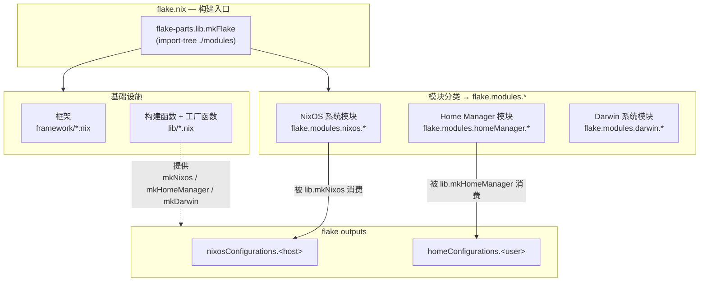
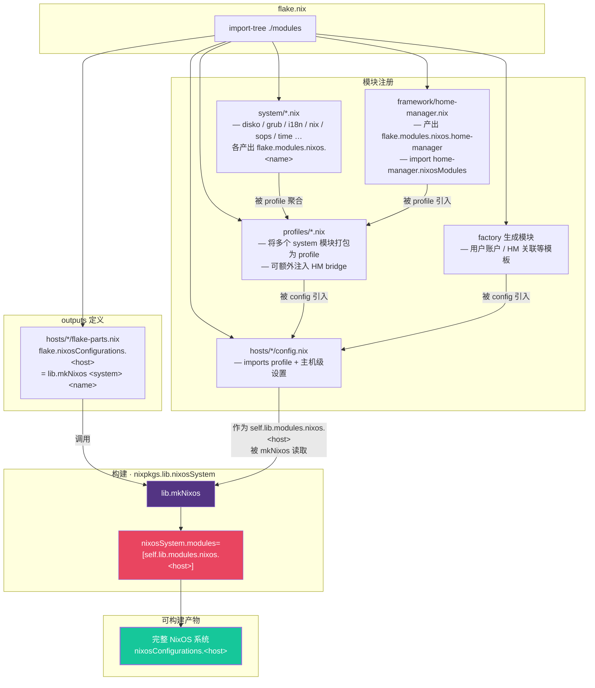
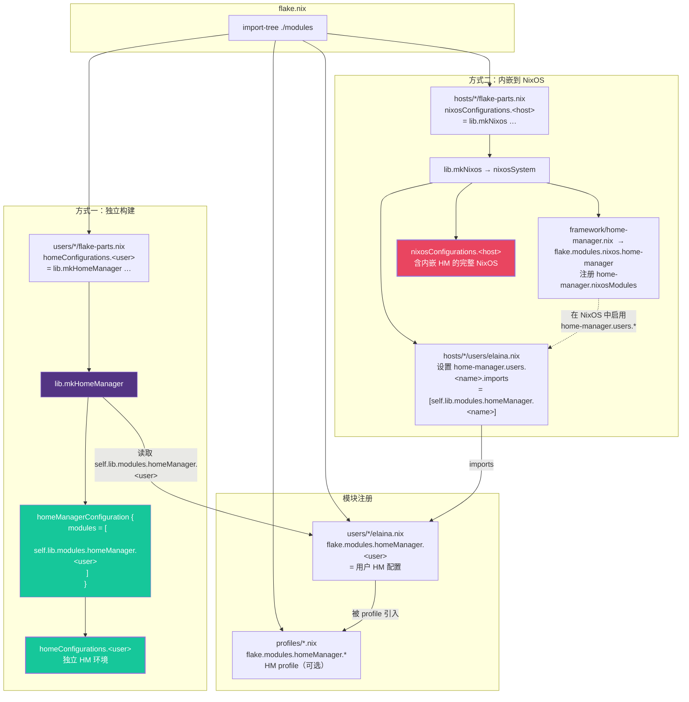

# Module System Architecture

## 1. 概览



所有 `.nix` 文件通过 `import-tree ./modules` 被 flake.nix 统一加载，各自贡献到 `flake.modules.*`、`flake.lib.*`、`flake.nixosConfigurations` 等属性上。

### 模块注册表与导入视图

- `flake.modules.<class>.<name>`：模块的原始注册表，由 flake-parts 的 `flakeModules.modules` 扩展维护。
- `flake.lib.modules.<class>.<name>`：为每个注册条目自动派生稳定 `key`（`"flake.modules.<class>.<name>"`）的导入视图，定义在 `lib/keyedModules.nix`。

> [!note]
> - `flake.modules.<class>.<name>` 可在 `nix repl .` 中用 `modules.<class>.<name>` 查阅。
> - `flake.lib.modules.<class>.<name>` 可在 `nix repl .` 中用 `lib.modules.<class>.<name>` 查阅。

Nix 模块系统按模块的 `key` 去重（`genericClosure`）。flake-parts 在包装 `flake.modules` 时只设置 `_class` / `_file`，不设置 `key`，因此直接导入 `self.modules.*` 的同一模块从多个位置进入求值时会被展开多次（列表型选项可能出现重复条目）。`flake.lib.modules` 补齐了这个 `key`，所以：

**约定：所有模块导入都使用 `self.lib.modules.*` / `inputs.self.lib.modules.*`，不要直接导入 `self.modules.*`。**

---

## 2. `flake.modules.nixos.*` 途径



### 分层汇聚关系

```
system/*.nix      ──→ flake.modules.nixos.<功能>     (单一功能)
profiles/*.nix    ──→ flake.modules.nixos.<profile>   (功能聚合)
hosts/*/config.nix ──→ flake.modules.nixos.<host>     (主机全集)
```

最终 `lib.mkNixos` 将 `self.lib.modules.nixos.<host>` 传给 `nixpkgs.lib.nixosSystem`。

---

## 3. `flake.modules.homeManager.*` 途径



### 两种使用方式

| 方式 | 产出 | 适用场景 |
|---|---|---|
| **独立构建** | `homeConfigurations.<user>` | 非 NixOS 系统、单独测试 |
| **内嵌到 NixOS** | `nixosConfigurations.<host>` 内含 HM | NixOS 生产环境 |

内嵌链路：`framework/home-manager.nix` 产出 `flake.modules.nixos.home-manager`（即 NixOS 端的 HM 入口），被 profile 引入 NixOS 系统后，主机用户模块通过 `home-manager.users.<name>.imports` 指向 `self.lib.modules.homeManager.<name>`。
